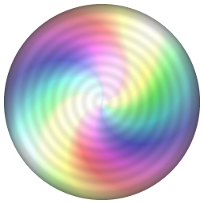
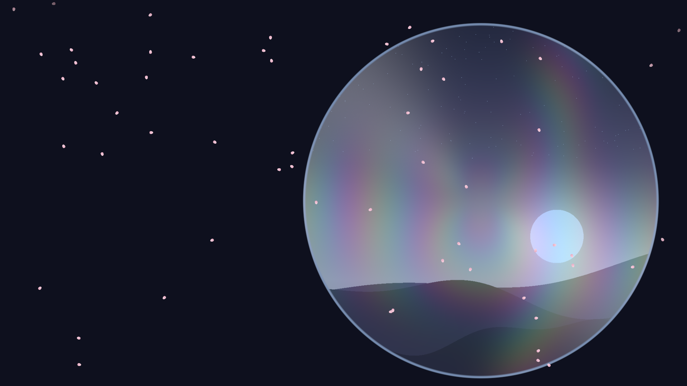
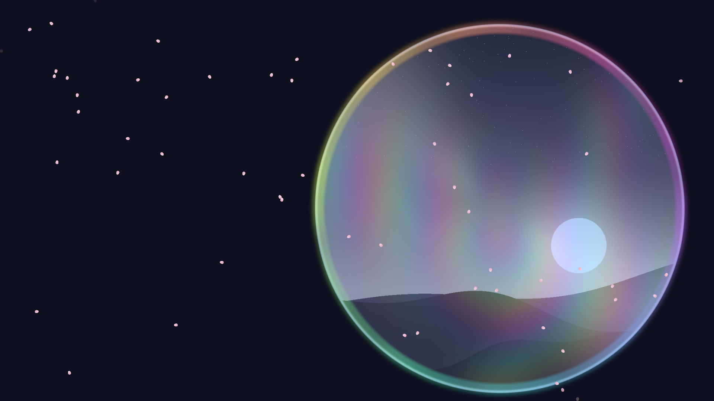
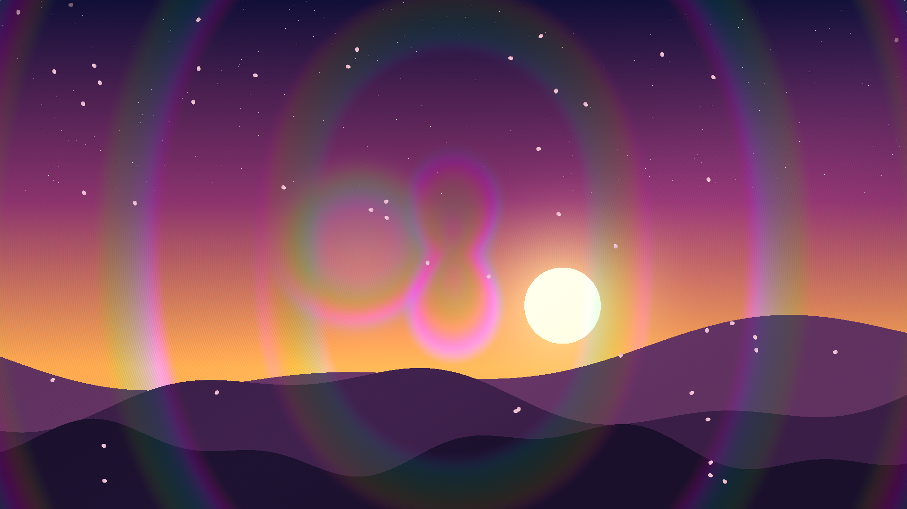

<p align="center">
  
</p>

<h1 align="center">Nijikage-Wallpaper</h1>

<p align="center">
  <a href="README.md">繁體中文</a> ·
  <a href="README.en.md">English</a> ·
  <a href="README.ja.md">日本語</a>
</p>

Nijikage-Wallpaper is a Windows 11 live wallpaper built around the **optics of a disc's data side — refraction, reflections, rainbow diffraction, light that follows your cursor, and particle effects**. Show a slowly spinning disc with your own artwork and an audio-reactive rainbow ring around its rim, or hide the disc and apply the same optical effects to your entire desktop background.

**About the name:** Nijikage (虹影) combines the Japanese words 虹 (*niji*, rainbow) and 影 (*kage*, shadow) — rainbow diffraction and the play of light and shadow. The full project name, Nijikage-Wallpaper, simply makes it clear that this is a wallpaper app.

> The beauty of light and shadow lives within our everyday lives.
> Why not relax, and let light and shadow keep you company.

> [!WARNING]
> **This is a beta release.** It works, but it has only been tested on a small number of setups (see "Tested environment"), so there may be problems nobody has found yet. Please don't rely on it for an important presentation or livestream, and do report issues.

## Screenshots

| Disc mode | Audio-reactive ring | Full-desktop mode |
|---|---|---|
|  |  |  |

> These are offscreen renders of a procedurally generated sunset landscape — no personal content. See `crates/nijikage-wallpaper-render/examples/screenshots.rs`.

## Features

- **Two modes**
  - **Disc mode** — place the disc anywhere (it may extend past the screen edge). The surface is continuous; there is no center hole.
  - **Full-desktop mode** — no disc; the optical effects are applied to the whole desktop background.
- **Disc artwork** — the full original image is used (no pre-cropping). Move, zoom (0.2–4×) and rotate it; whatever falls outside the disc is hidden, and empty areas show the bare disc surface. The image is automatically tinted to a disc tone (CD silver / DVD gold-purple / Blu-ray blue-purple).
- **Optics** — anisotropic concentric-groove highlights, rainbow diffraction, wide light bands that sweep with the rotation speed, a cursor light source with local refraction. The artwork stays still while the reflected light turns.
- **Audio-reactive ring** — reads the loudness of whatever your system is playing and draws a rainbow ring on the disc's outer edge that moves with volume and frequency, fading out when the sound stops.
- **Particles** — rain, wind, falling leaves, cherry blossoms, on the disc or across the desktop; the cursor pushes them around.
- **Custom background** — image or solid color, with the same fit modes as Windows personalization (Fill, Fit, Stretch, Tile, Center, Span).
- **Settings window** — every feature can be toggled; changes apply instantly and are saved automatically. A 16:9 layout preview lets you drag the disc and the artwork.
- **Three UI languages** — English, Traditional Chinese, Japanese (follows the Windows display language by default; can be changed).
- **Efficient and stable** — 30 fps by default, pauses automatically when a full-screen app is running, optional start with Windows, controlled from the system tray.

## Requirements and compatibility

| Item | Requirement |
|---|---|
| OS | Windows 11, 64-bit (developed and tested on 26H2, build 26300) |
| GPU | DirectX 12 or Vulkan capable (an Intel iGPU is enough; tested on Intel UHD Graphics 750) |
| Audio-reactive ring | A default audio output device (WASAPI loopback) |
| Displays | Primary display only for now |

Recent Windows 11 builds merge the desktop-icon layer and the wallpaper layer into `Progman` (with `WS_EX_NOREDIRECTIONBITMAP`), so a third-party wallpaper window only shows up if it is attached in a specific order — see [docs/ARCHITECTURE.md](docs/ARCHITECTURE.md). Windows 10 and other Windows 11 builds have a different desktop structure and are **untested**.

## Installation

### MSI installer (recommended)

1. Download `Nijikage-Wallpaper-<version>-x64.msi` from [Releases](../../releases).
2. Double-click to install (per-user; no administrator rights needed).
3. Start **Nijikage-Wallpaper** from the Start menu. The wallpaper appears behind your desktop icons and an icon shows up in the system tray.

### Portable ZIP

1. Download `Nijikage-Wallpaper-<version>-x64.zip` and extract it anywhere.
2. Run `nijikage-wallpaper.exe`. Keep `nijikage-wallpaper.exe` and `nijikage-wallpaper-settings.exe` in the same folder.

> The executables are **not code-signed**, so Windows SmartScreen may show a warning. Make sure you downloaded from this project's Releases page, and verify the files with `SHA256SUMS.txt`.

## Usage

1. After Nijikage-Wallpaper starts, right-click the tray icon: **Settings…** / **Pause wallpaper** / **Quit Nijikage-Wallpaper**.
2. In the settings window, choose an image or solid color on the **Background** tab, and pick "Disc mode" or "Full-desktop mode" on the **Disc** tab.
3. **Disc mode** — in the layout preview, drag the disc to move it and scroll to resize it; hold `Shift` and drag to move the artwork, `Shift` + scroll to zoom it; hold `Alt` and drag (or use the slider) to rotate it. Enable the audio-reactive ring if you want it.
4. **Full-desktop mode** — adjust the effect strength (0–1) and the pattern scale; particle effects use the "whole desktop" set.
5. Everything applies instantly and is saved to `%APPDATA%\Nijikage-Wallpaper\config.json`.

## Known limitations and issues

- **Primary display only**; with multiple displays, positions may be wrong when a secondary display sits to the left of or above the primary.
- Tested only on Windows 11 26H2 (build 26300) with an Intel UHD Graphics 750; other Windows versions and GPUs are untested.
- When Explorer restarts, the program restarts itself and re-attaches; this mechanism has **not been tested**.
- Cursor interaction feel, long-running 30 fps behavior and drag operations in the settings window have mostly been verified through automated tests and static frames — feedback on how it feels is welcome.
- Full-desktop mode at strength 1.0 is very colorful; lower the strength if it is too much.
- The executables are not code-signed.
- Third-party desktop tools that hook Explorer or alter desktop composition may interfere with attachment; this has not been tested systematically.

## Tested environment

| Item | Version |
|---|---|
| Windows | 11 26H2 (build 26300.9711) |
| GPU | Intel UHD Graphics 750 (driver 31.0.101.1999) |
| Resolution | 1920×1080, single display |
| Rust | 1.99 (`x86_64-pc-windows-gnu`) |

## Building from source

You need [Rust](https://rustup.rs/) (edition 2024, Rust 1.85 or newer). Development and testing currently use the `x86_64-pc-windows-gnu` (MinGW) toolchain.

```bash
git clone https://github.com/HiRo-by-ANAN/Nijikage-Wallpaper.git
cd Nijikage-Wallpaper
cargo build --release
```

The output is in `target/release/`: `nijikage-wallpaper.exe` and `nijikage-wallpaper-settings.exe`.

```bash
cargo test --release            # unit tests and offscreen GPU tests (needs a working GPU)
cargo run --release -p nijikage-wallpaper-render --example screenshots -- docs/images   # regenerate the screenshots
```

To build the MSI, see [packaging/README.md](packaging/README.md).

## Security and privacy

- **No network, no telemetry** — Nijikage-Wallpaper never connects to the internet and never collects or uploads anything.
- **Audio-reactive ring** — uses the official Windows WASAPI loopback API and **only computes overall loudness and 16 frequency bands in memory**. It does not record, save or upload audio, and does not read other processes' memory. When the ring is turned off, audio capture is never started.
- **Local writes** — the config file `%APPDATA%\Nijikage-Wallpaper\config.json` and the log `%APPDATA%\Nijikage-Wallpaper\log.txt`; turning on "Start with Windows" writes to `HKCU\Software\Microsoft\Windows\CurrentVersion\Run` (removed when you turn it off or uninstall).
- **Reads** — only the image files you choose in the settings.
- To report a security issue, see [SECURITY.md](SECURITY.md).

## Disclaimer

This software is provided "as is", without warranty of any kind. The author is not liable for any damage resulting from its use. It attaches a window to the Windows desktop layer; please evaluate the risk yourself. See [LICENSE](LICENSE).

This project is maintained by one person in their spare time, so no fixed response or fix schedule can be guaranteed.

## Development notes

- Written in Rust: `wgpu` for GPU rendering, `winit` for windowing, `egui`/`eframe` for the settings window, the `windows` crate for Win32 and WASAPI.
- The first version took one day to build. The author wrote, organized and tested the code in collaboration with Claude (Sonnet 5.5 / Opus 5.5), OpenAI Codex (GPT-6.1 Sol) and Google Antigravity (Gemini 4 / 3.8 Flash).
- The desktop-attachment approach for recent Windows builds draws on how the open-source project [Lively Wallpaper](https://github.com/rocksdanister/lively) handles them — thank you.
- The program icon is generated by code.

## Project documents

- [docs/ARCHITECTURE.md](docs/ARCHITECTURE.md) — architecture, how desktop attachment works, diagnostics
- [packaging/README.md](packaging/README.md) — building the MSI installer
- [CHANGELOG.md](CHANGELOG.md) — release notes
- [CONTRIBUTING.md](CONTRIBUTING.md) — how to contribute
- [CODE_OF_CONDUCT.md](CODE_OF_CONDUCT.md) — code of conduct
- [SECURITY.md](SECURITY.md) — security policy
- [THIRD_PARTY_LICENSES.md](THIRD_PARTY_LICENSES.md) — third-party licenses

## License

Released under **GPL-3.0-or-later**; see [LICENSE](LICENSE). Third-party dependencies are covered by their own licenses, listed in [THIRD_PARTY_LICENSES.md](THIRD_PARTY_LICENSES.md).

## Trademarks

Windows and DirectX are trademarks of Microsoft Corporation. This project is not affiliated with or endorsed by Microsoft.

This project is not affiliated with any other group, work or product that uses a similar name (for example a fansub group, fan fiction setting or another piece of software).
