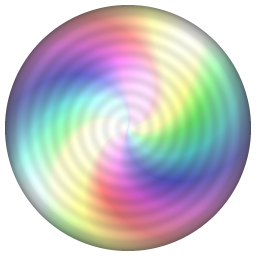
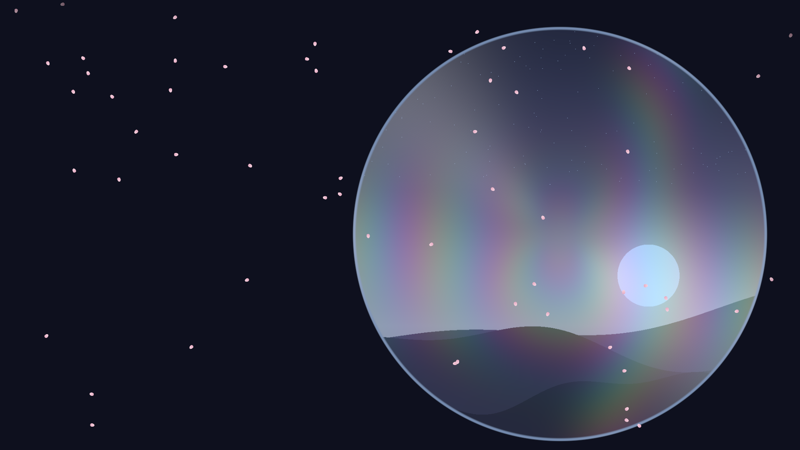
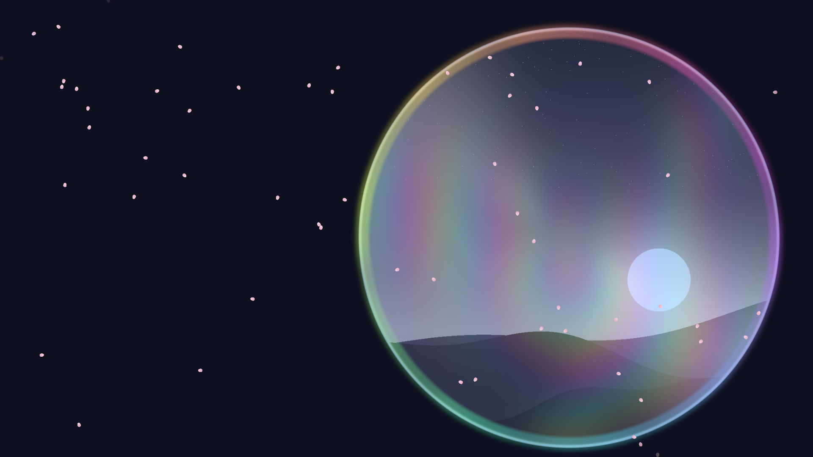

<p align="center">
  
</p>

<h1 align="center">Nijikage-Wallpaper</h1>

<p align="center">
  <a href="README.md">繁體中文</a> ·
  <a href="README.en.md">English</a> ·
  <a href="README.ja.md">日本語</a>
</p>

Nijikage-Wallpaper は、**ディスク記録面の屈折・反射・虹色の回折・カーソルに反応する光・パーティクル**を Windows 11 のデスクトップに映す動的壁紙です。好きな画像を載せたディスクをゆっくり回し、外周にはシステム音に反応する虹色のリングを表示できます。ディスクを表示せずに、同じ光学効果をデスクトップ背景全体へ適用することもできます。

**名前の由来：** Nijikage（虹影）は「虹（にじ）」と「影（かげ）」を組み合わせた名前で、虹色の回折と光と影の移ろいを表しています。プロジェクト名の Nijikage-Wallpaper は、壁紙アプリであることが一目で分かるようにしたものです。

> 光と影の美しさは、私たちの日常の中にひそんでいます。
> 肩の力を抜いて、光と影にそっと寄り添ってもらいましょう。

> [!WARNING]
> **現在はベータ版です。** 動作はしますが、限られた環境でしかテストしていません（「動作確認環境」参照）。未発見の問題がある可能性があります。重要なプレゼンテーションや配信では頼らないでください。問題はぜひ報告してください。

## スクリーンショット

| ディスクモード | オーディオ連動リング | デスクトップ全体モード |
|---|---|---|
|  |  |  |

> 上の画像は、プログラムが生成した夕焼けの風景を使ったオフスクリーン描画で、個人的な内容は含みません。生成方法は `crates/nijikage-wallpaper-render/examples/screenshots.rs` を参照してください。

## 機能

- **2 つのモード**
  - **ディスクモード** — ディスクの中心と直径を自由に設定できます（画面外へはみ出してもかまいません）。盤面は連続していて、中心に穴はありません。
  - **デスクトップ全体モード** — ディスクを表示せず、光学効果をデスクトップ背景全体に適用します。
- **ディスク画像** — 元画像全体を使用します（事前の切り抜きなし）。移動、拡大縮小（0.2～4 倍）、回転ができ、ディスクからはみ出した部分は表示されず、画像が足りない部分にはディスク面そのものが見えます。画像は自動的にディスクの色調（CD シルバー／DVD ゴールド＆パープル／Blu-ray ブルー＆パープル）になります。
- **光学効果** — 異方性の同心円グルーブのハイライト、虹色の回折、回転に合わせて流れる広い光帯、局所的な屈折を伴うカーソル光源。ディスクが回っても画像は動かず、動くのは反射光です。
- **オーディオ連動リング** — システムが再生している音の大きさを読み取り、ディスクの外周に音量と周波数に合わせて動く虹色のリングを表示します。音が止まるとフェードアウトします。
- **パーティクル** — 雨、風、落ち葉、桜。ディスク上またはデスクトップ全体に配置でき、カーソルで散らせます。
- **背景のカスタマイズ** — 画像または単色。配置方法は Windows の個人用設定と同じです（拡大して全体に表示、画面のサイズに合わせる、引き伸ばす、並べて表示、中央に表示、スパン）。
- **設定ウィンドウ** — すべての機能をオン／オフでき、変更は即座に反映されて自動保存されます。16:9 のレイアウトプレビューで、ディスクや画像を直接ドラッグできます。
- **3 つの表示言語** — 日本語、繁体字中国語、English（既定では Windows の表示言語に従い、手動で変更できます）。
- **省電力と安定性** — 既定は 30 fps、全画面アプリの実行中は自動で一時停止、Windows 起動時の自動開始、タスクトレイから操作できます。

## 動作環境と互換性

| 項目 | 要件 |
|---|---|
| OS | Windows 11 64 ビット（開発・動作確認：26H2、ビルド 26300） |
| GPU | DirectX 12 または Vulkan 対応（Intel 内蔵 GPU で十分。Intel UHD Graphics 750 で確認） |
| オーディオ連動リング | 既定のオーディオ出力デバイス（WASAPI loopback） |
| ディスプレイ | 現時点ではプライマリディスプレイのみ |

最近の Windows 11 ではデスクトップアイコン層と壁紙層が `Progman`（`WS_EX_NOREDIRECTIONBITMAP` 付き）に統合されており、サードパーティの壁紙ウィンドウは特定の順序で取り付けないと表示されません。詳細は [docs/ARCHITECTURE.md](docs/ARCHITECTURE.md) を参照してください。Windows 10 やその他の Windows 11 ビルドはデスクトップの構造が異なり、**未検証**です。

## インストール

### MSI インストーラー（推奨）

1. [Releases](../../releases) から `Nijikage-Wallpaper-<バージョン>-x64.msi` をダウンロードします。
2. ダブルクリックでインストールします（現在のユーザー用。管理者権限は不要です）。
3. スタートメニューから **Nijikage-Wallpaper** を起動します。デスクトップアイコンの後ろに壁紙が表示され、タスクトレイにアイコンが現れます。

### ポータブル ZIP

1. `Nijikage-Wallpaper-<バージョン>-x64.zip` をダウンロードし、任意のフォルダーに展開します。
2. `nijikage-wallpaper.exe` を実行します。`nijikage-wallpaper.exe` と `nijikage-wallpaper-settings.exe` は同じフォルダーに置いてください。

> 実行ファイルには**コード署名がありません**。Windows SmartScreen の警告が表示されることがあります。本プロジェクトの Releases ページからダウンロードしたことを確認し、`SHA256SUMS.txt` でファイルを検証してください。

## 使い方

1. Nijikage-Wallpaper を起動したら、タスクトレイのアイコンを右クリックします：**設定…**／**壁紙を一時停止**／**Nijikage-Wallpaper を終了**。
2. 設定ウィンドウの **背景** タブで画像または単色を選び、**ディスク** タブで「ディスクモード」か「デスクトップ全体モード」を選びます。
3. **ディスクモード** — レイアウトプレビューでディスクをドラッグして移動、ホイールで直径を変更。`Shift` を押しながらドラッグで画像を移動、`Shift` ＋ホイールで画像を拡大縮小。`Alt` を押しながらドラッグ（または回転スライダー）で画像を回転します。必要に応じてオーディオ連動リングを有効にします。
4. **デスクトップ全体モード** — エフェクト強度（0～1）とパターンのスケールを調整します。パーティクルは「デスクトップ全体」の設定が使われます。
5. すべての設定は即座に反映され、`%APPDATA%\Nijikage-Wallpaper\config.json` に自動保存されます。

## 既知の制限と問題

- **プライマリディスプレイのみ**対応しています。マルチディスプレイで、サブディスプレイがプライマリの左または上にある場合、位置がずれることがあります。
- Windows 11 26H2（ビルド 26300）と Intel UHD Graphics 750 でのみ検証しています。他の Windows バージョンや GPU は未検証です。
- エクスプローラーの再起動時にプログラムが自動で再起動して再取り付けする仕組みは、**検証していません**。
- カーソル操作の感触、長時間の 30 fps 動作、設定ウィンドウでのドラッグ操作は、主に自動テストと静止画で確認しています。使用感のフィードバックを歓迎します。
- デスクトップ全体モードの強度 1.0 は色がかなり濃くなります。強すぎる場合は強度を下げてください。
- 実行ファイルにコード署名はありません。
- エクスプローラーにフックするなど、デスクトップの合成を変更するサードパーティ製ツールは、取り付けに影響する可能性があります（体系的なテストは未実施）。

## 動作確認環境

| 項目 | バージョン |
|---|---|
| Windows | 11 26H2（ビルド 26300.9711） |
| GPU | Intel UHD Graphics 750（ドライバー 31.0.101.1999） |
| 解像度 | 1920×1080、シングルディスプレイ |
| Rust | 1.99（`x86_64-pc-windows-gnu`） |

## ソースからのビルド

[Rust](https://rustup.rs/)（edition 2024、Rust 1.85 以上）が必要です。現在は `x86_64-pc-windows-gnu`（MinGW）ツールチェーンで開発・テストしています。

```bash
git clone https://github.com/HiRo-by-ANAN/Nijikage-Wallpaper.git
cd Nijikage-Wallpaper
cargo build --release
```

成果物は `target/release/` にあります：`nijikage-wallpaper.exe`、`nijikage-wallpaper-settings.exe`。

```bash
cargo test --release            # 単体テストとオフスクリーン GPU テスト（動作する GPU が必要）
cargo run --release -p nijikage-wallpaper-render --example screenshots -- docs/images   # スクリーンショットの再生成
```

MSI のビルドについては [packaging/README.md](packaging/README.md) を参照してください。

## セキュリティとプライバシー

- **ネットワーク通信なし、テレメトリなし** — Nijikage-Wallpaper はインターネットに接続せず、データの収集や送信を一切行いません。
- **オーディオ連動リング** — Windows 公式の WASAPI loopback を使い、**全体の音量と 16 の周波数帯域をメモリ上で計算するだけ**です。録音・保存・送信は行わず、他のプロセスのメモリも読み取りません。リングを無効にしているときは、音声の取得自体を開始しません。
- **ローカルへの書き込み** — 設定ファイル `%APPDATA%\Nijikage-Wallpaper\config.json` とログ `%APPDATA%\Nijikage-Wallpaper\log.txt`。「Windows 起動時に開始」を有効にすると `HKCU\Software\Microsoft\Windows\CurrentVersion\Run` に書き込みます（無効化またはアンインストール時に削除されます）。
- **読み取り** — 設定で選んだ画像ファイルのみです。
- セキュリティ上の問題の報告方法は [SECURITY.md](SECURITY.md) を参照してください。

## 免責事項

本ソフトウェアは「現状のまま」提供され、いかなる保証もありません。使用により生じた損害について、作者は責任を負いません。本ソフトウェアは Windows のデスクトップ層にウィンドウを取り付けます。リスクはご自身で判断してください。詳細は [LICENSE](LICENSE) を参照してください。

本プロジェクトは個人が余暇に保守しているため、返信や修正の時期をお約束することはできません。

## 開発について

- Rust で記述：GPU 描画に `wgpu`、ウィンドウに `winit`、設定ウィンドウに `egui`／`eframe`、Win32 と WASAPI の呼び出しに `windows` クレートを使用しています。
- 初版の制作期間は 1 日です。作者は Claude（Sonnet 5.5 / Opus 5.5）、OpenAI Codex（GPT-6.1 Sol）、Google Antigravity（Gemini 4 / 3.8 Flash）と協力して、コードの作成・整理・テストを行いました。
- 新しい Windows でのデスクトップ取り付け方法は、オープンソースの [Lively Wallpaper](https://github.com/rocksdanister/lively) の対応方法を参考にしました。感謝します。
- アプリのアイコンはプログラムで生成しています。

## プロジェクト文書

- [docs/ARCHITECTURE.md](docs/ARCHITECTURE.md) — アーキテクチャ、デスクトップへの取り付けの仕組み、診断方法
- [packaging/README.md](packaging/README.md) — MSI インストーラーのビルド
- [CHANGELOG.md](CHANGELOG.md) — 変更履歴
- [CONTRIBUTING.md](CONTRIBUTING.md) — 貢献方法
- [CODE_OF_CONDUCT.md](CODE_OF_CONDUCT.md) — 行動規範
- [SECURITY.md](SECURITY.md) — セキュリティポリシー
- [THIRD_PARTY_LICENSES.md](THIRD_PARTY_LICENSES.md) — サードパーティのライセンス

## ライセンス

**GPL-3.0-or-later** で公開しています。詳細は [LICENSE](LICENSE) を参照してください。サードパーティの依存パッケージにはそれぞれのライセンスが適用され、[THIRD_PARTY_LICENSES.md](THIRD_PARTY_LICENSES.md) に記載しています。

## 商標

Windows および DirectX は Microsoft Corporation の商標です。本プロジェクトは Microsoft とは無関係であり、承認も受けていません。

本プロジェクトは、同じまたは似た名前を使う他の団体・作品・製品（たとえば同名の字幕グループ、二次創作の設定、他のソフトウェアなど）とは無関係です。
