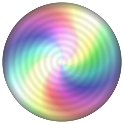

<p align="center">
  
</p>

<h1 align="center">Nijikage-Wallpaper 虹影</h1>

<p align="center">
  <a href="README.md">繁體中文</a> ·
  <a href="README.en.md">English</a> ·
  <a href="README.ja.md">日本語</a>
</p>

Nijikage-Wallpaper 是一款 Windows 11 動態桌布：把**光碟背面的折射、反光、彩虹繞射、光線互動與粒子特效**放進桌面。你可以讓一片光碟在桌面上慢慢旋轉，盤面放上自己的圖片，最外圈隨系統播放的聲音出現彩虹色動態環；也可以不顯示光碟，把同樣的光學效果直接套用到整個桌面背景。

**English:** Nijikage-Wallpaper is a Windows 11 live wallpaper built around the optics of a disc's data side — refraction, reflections, rainbow diffraction, light that follows your cursor, and particle effects. Show a slowly spinning disc with your own artwork and an audio-reactive rainbow ring, or apply the same optical effects to your whole desktop background.

**日本語:** Nijikage-Wallpaper は、ディスク記録面の屈折・反射・虹色の回折・カーソルに反応する光・パーティクルを Windows 11 のデスクトップに映す動的壁紙です。好きな画像を載せた回転ディスクと、システム音に反応する虹色のリングを表示することも、同じ光学効果をデスクトップ背景全体に適用することもできます。

**名稱由來：** Nijikage（虹影）取自日文「虹（にじ／niji）」與「影（かげ／kage）」，意指彩虹繞射與光影的變化；專案全名 Nijikage-Wallpaper 則是為了讓搜尋時一眼看出這是桌布軟體。

> 光影之美，藏在你我生活之中
> 不如放鬆心情，讓光影陪伴你。

> [!WARNING]
> **目前為 Beta 版本。** 功能可以使用，但只在少數環境實測過（見「實測環境」），可能有尚未發現的問題。請不要在重要的簡報或直播場合依賴它，並歡迎回報問題。

## 展示

| 光碟模式 | 音訊動態環 | 全桌面模式 |
|---|---|---|
|  |  |  |

> 以上為程式離屏渲染的示意圖，使用程式產生的日落風景，不含任何個人內容。產生方式見 `crates/nijikage-wallpaper-render/examples/screenshots.rs`。

## 功能

- **兩種模式**
  - **光碟模式**：光碟圓心、直徑可任意設定（可部分出界）；盤面連續、中心沒有洞。
  - **全桌面模式**：不顯示光碟，把光學效果套用到整個桌面背景。
- **光碟盤面圖片**：使用完整原圖（不預先裁切），可移動、縮放（0.2～4 倍）、旋轉；超出光碟的部分不顯示，圖片不足處顯示盤面本色。圖片會自動變成光碟盤的色調（CD 銀白／DVD 金紫／藍光藍紫）。
- **光學效果**：各向異性同心細紋高光、彩虹繞射、隨轉速掃過的光帶、游標光源與局部折射；光碟轉動時圖片固定不動，轉的是反射光。
- **音訊動態環**：擷取系統播放的聲音強度，光碟最外圈出現彩虹色動態環，隨音量與頻率起伏，聲音停止後淡出。
- **粒子特效**：雨滴、風、落葉、櫻花，可分別放在光碟上或整個桌面；游標滑過會撥動粒子。
- **自訂背景**：圖片或純色，排列方式同 Windows 個人化（填滿、符合、伸展、並排、置中、跨螢幕）。
- **設定視窗**：所有功能都能開關，改動即時生效並自動儲存；光碟版面有 16:9 預覽，可直接拖曳光碟與圖片。
- **三種介面語言**：繁體中文、English、日本語（預設依系統顯示語言，可手動切換）。
- **省電與穩定**：預設 30 fps、全螢幕程式執行時自動暫停、可開機自啟動、系統托盤控制。

## 系統需求與相容性

| 項目 | 需求 |
|---|---|
| 作業系統 | Windows 11 64 位元（開發與實測：26H2，build 26300） |
| 顯示卡 | 支援 DirectX 12 或 Vulkan（Intel 內顯即可，實測 Intel UHD Graphics 750） |
| 音訊動態環 | 需要有預設的音訊輸出裝置（WASAPI loopback） |
| 螢幕 | 目前只支援主螢幕 |

Windows 11 較新版本把桌面圖示層與桌布層合併進 `Progman`（含 `WS_EX_NOREDIRECTIONBITMAP`），第三方桌布視窗必須用特定順序掛載才會顯示，細節見 [docs/ARCHITECTURE.md](docs/ARCHITECTURE.md)。Windows 10 與其他 Windows 11 版本的桌面結構不同，**尚未實測**。

## 安裝

### 使用 MSI 安裝（建議）

1. 到 [Releases](../../releases) 下載 `Nijikage-Wallpaper-<版本>-x64.msi`。
2. 雙擊安裝（只安裝給目前使用者，不需要系統管理員權限）。
3. 從開始功能表啟動 **Nijikage-Wallpaper**；桌面圖示後方會出現桌布，右下角托盤會出現圖示。

### 使用免安裝 ZIP

1. 下載 `Nijikage-Wallpaper-<版本>-x64.zip` 並解壓縮到任一資料夾。
2. 雙擊 `nijikage-wallpaper.exe`。兩個 exe（`nijikage-wallpaper.exe`、`nijikage-wallpaper-settings.exe`）必須放在同一個資料夾。

> 目前的執行檔**沒有數位簽章**，Windows SmartScreen 可能會顯示警告，請確認下載來源是本專案的 Releases 頁面，並可用 `SHA256SUMS.txt` 核對檔案。

## 使用方式

1. 啟動 Nijikage-Wallpaper 後，在系統托盤圖示按右鍵：**設定…**／**暫停桌布**／**結束 Nijikage-Wallpaper**。
2. 在設定視窗的 **背景** 分頁選圖片或純色；在 **光碟** 分頁選擇「光碟模式」或「全桌面模式」。
3. **光碟模式**：在版面預覽中拖曳光碟移動、滾輪縮放；按住 `Shift` 拖曳移動圖片、`Shift`＋滾輪縮放圖片；按住 `Alt` 拖曳或使用旋轉滑桿旋轉圖片。需要時開啟「音訊動態環」。
4. **全桌面模式**：調整效果強度（0～1）與紋路尺度；粒子特效使用「整個桌面」那一組。
5. 所有設定即時生效並自動儲存到 `%APPDATA%\Nijikage-Wallpaper\config.json`。

## 已知限制及問題

- 只支援**主螢幕**；多螢幕或副螢幕位於主螢幕左／上方時位置可能不對。
- 只在 Windows 11 26H2（build 26300）、Intel UHD Graphics 750 實測；其他 Windows 版本、其他顯示卡尚未測試。
- 檔案總管重新啟動時，程式會自動重新啟動並重新掛載，這個機制**沒有實測**。
- 游標互動手感、長時間 30 fps 表現、設定視窗拖曳操作，目前以自動化測試與靜態畫面驗證為主，歡迎回報手感問題。
- 全桌面模式強度 1.0 的顏色相當濃烈，可降低強度。
- 執行檔沒有數位簽章。
- 部分第三方桌面工具（會鉤進檔案總管、修改桌面合成的軟體）可能與桌面掛載互相影響，尚未系統性測試。

## 實測環境

| 項目 | 版本 |
|---|---|
| Windows | 11 26H2（build 26300.9711） |
| 顯示卡 | Intel UHD Graphics 750（驅動 31.0.101.1999） |
| 解析度 | 1920×1080，單螢幕 |
| Rust | 1.99（`x86_64-pc-windows-gnu`） |

## 從原始碼建置

需要 [Rust](https://rustup.rs/)（edition 2024，Rust 1.85 以上）。目前以 `x86_64-pc-windows-gnu`（MinGW）工具鏈開發與測試。

```bash
git clone https://github.com/HiRo-by-ANAN/Nijikage-Wallpaper.git
cd Nijikage-Wallpaper
cargo build --release
```

產物在 `target/release/`：`nijikage-wallpaper.exe`、`nijikage-wallpaper-settings.exe`。

```bash
cargo test --release            # 單元測試與離屏 GPU 測試（需要可用的 GPU）
cargo run --release -p nijikage-wallpaper-render --example screenshots -- docs/images   # 產生示意圖
```

建置 MSI 請見 [packaging/README.md](packaging/README.md)。

## 安全性與隱私

- **不連網、無遙測**：Nijikage-Wallpaper 不會對外連線，不收集、不上傳任何資料。
- **音訊動態環**：使用 Windows 官方的 WASAPI loopback，**只在記憶體中計算整體音量與 16 個頻帶**，不錄音、不儲存、不上傳，也不讀取其他程式的記憶體。關閉「音訊動態環」時，程式完全不會啟動音訊擷取。
- **本機寫入**：設定檔 `%APPDATA%\Nijikage-Wallpaper\config.json` 與紀錄檔 `%APPDATA%\Nijikage-Wallpaper\log.txt`；開啟「開機自啟動」時會寫入 `HKCU\Software\Microsoft\Windows\CurrentVersion\Run`（關閉或解除安裝時移除）。
- **讀取**：只讀取你在設定中選的圖片檔。
- 回報安全問題請見 [SECURITY.md](SECURITY.md)。

## 免責聲明

本軟體依「現狀」提供，不附帶任何明示或默示的保證。因使用本軟體造成的任何損失，作者不負責任。本軟體會把視窗掛載到 Windows 桌面層，請自行評估風險。詳見 [LICENSE](LICENSE)。

本專案由個人利用課餘時間維護，無法保證固定的回覆或修正時程。

## 開發說明

- 以 Rust 撰寫：`wgpu` 負責 GPU 繪製、`winit` 建立視窗、`egui`／`eframe` 製作設定視窗、`windows` crate 呼叫 Win32 與 WASAPI。
- 初版共耗時 1 天製作。專案作者透過 Claude（Sonnet 5.5 / Opus 5.5）、OpenAI Codex（GPT-6.1 Sol）與 Google Antigravity（Gemini 4 / 3.8 Flash）協作撰寫、整理及測試程式碼。
- 桌面掛載的做法參考了開源專案 [Lively Wallpaper](https://github.com/rocksdanister/lively) 對新版 Windows 桌面結構的處理，並在此致謝。
- 程式圖示由程式產生。

## 專案文件

- [docs/ARCHITECTURE.md](docs/ARCHITECTURE.md) — 架構、桌面掛載原理與診斷方式
- [packaging/README.md](packaging/README.md) — 建置 MSI 安裝檔
- [CHANGELOG.md](CHANGELOG.md) — 版本紀錄
- [CONTRIBUTING.md](CONTRIBUTING.md) — 參與貢獻
- [CODE_OF_CONDUCT.md](CODE_OF_CONDUCT.md) — 行為準則
- [SECURITY.md](SECURITY.md) — 安全性政策
- [THIRD_PARTY_LICENSES.md](THIRD_PARTY_LICENSES.md) — 第三方套件授權

## 授權

本專案以 **GPL-3.0-or-later** 授權釋出，詳見 [LICENSE](LICENSE)。第三方相依套件各自適用其授權，列於 [THIRD_PARTY_LICENSES.md](THIRD_PARTY_LICENSES.md)。

## 商標

Windows 與 DirectX 是 Microsoft Corporation 的商標。本專案與 Microsoft 無關，也未獲其背書。

本專案與其他使用相同或相似名稱（例如同名的字幕組、同人設定或其他軟體）的團體、作品及產品無關。
